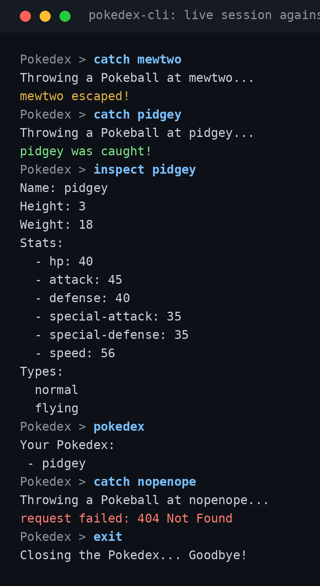

# Pokedex CLI

**A terminal Pokedex in Go: browse Pokemon location areas, see who lives there, throw Pokeballs, and inspect what you catch, all from a REPL backed by a cached PokeAPI client.**
 

*A real session against the live [PokeAPI](https://pokeapi.co/).*
 
## Motivation
 
A REPL, an HTTP client, a cache, and a bit of game logic fit in about 500 lines of Go. Dexterm is that stack with nothing extra: no CLI framework, no third-party modules, only the standard library.
 
The interesting parts are the small ones. Responses are cached by URL in a mutex-guarded map with a background goroutine that evicts stale entries. Catching a Pokemon is a weighted dice roll based on real API data. Go's `net/http`, `encoding/json`, `sync`, and `time` carry the rest.
 
## Quick Start
 
Requires [Go](https://go.dev/dl/) 1.21 or newer. `go.mod` pins Go 1.26.2, and Go 1.21+ downloads that toolchain on first build.
 
```bash
git clone https://github.com/amayakmt/pokedex-cli.git
cd pokedex-cli
go run .
```
 
You need internet access: every lookup goes to `pokeapi.co`.
 
To build a binary:
 
```bash
go build -o pokedex
./pokedex
```
 
## Usage
 
At the `Pokedex >` prompt, type a command and press Enter. Input is lowercased and split on whitespace.
 
| Command | What it does |
| --- | --- |
| `help` | Lists every command |
| `map` | Shows the next 20 location areas |
| `mapb` | Shows the previous 20 location areas |
| `explore <area>` | Lists the Pokemon that appear in a location area |
| `catch <pokemon>` | Throws a Pokeball at a Pokemon |
| `inspect <pokemon>` | Prints height, weight, stats, and types of a Pokemon you caught |
| `pokedex` | Lists everything you have caught |
| `exit` | Quits |
 
A typical run: `map` to find an area name, `explore pastoria-city-area` to see what lives there, `catch tentacool`, then `inspect tentacool`.
 
### Catch mechanics
 
A catch rolls a random integer from `0` up to the Pokemon's `base_experience`, and the Pokemon escapes if the roll is above 40. The odds are 41 divided by `base_experience`, capped at 100%:
 
| Pokemon | `base_experience` | Chance to catch |
| --- | --- | --- |
| pidgey | 50 | about 82% |
| tentacool | 67 | about 61% |
| mewtwo | 306 | about 13% |
 
Anything at or below 41 is always caught. A catch is stored under the name you typed, so catching the same Pokemon twice just overwrites the entry.
 
### Caching
 
Every API response is cached in memory by URL for 5 minutes (`main.go`: `pokeapi.NewClient(5 * time.Minute)`). Paging back through `mapb` and re-exploring an area hit the cache instead of the network. The cache is per run: your Pokedex and the cache both reset when you exit.
 
### Limits
 
- The Pokedex is not saved between runs.
- `map` past the last page wraps back to the first page.
- `pokedex` and `help` list entries in random order, because Go map iteration is unordered.
- `explore` is passed a location area name exactly as `map` prints it.
## Contributing
 
### Clone the repo
 
```bash
git clone https://github.com/amayakmt/pokedex-cli.git
cd pokedex-cli
```
 
### Run the tests
 
```bash
go test ./...
```
 
The tests cover `cleanInput` (trimming, lowercasing, splitting) and the cache (add, get, and eviction after the TTL). The API client and commands have no tests yet.
 
### Project layout
 
```text
main.go                        # REPL loop and config
repl.go                        # cleanInput
commands.go                    # Command table and handlers
internal/pokeapi/              # HTTP client plus location-area, location-areas, and pokemon calls
internal/pokecache/            # Mutex-guarded TTL cache with a reap loop
```
 
### Submit a pull request
 
Fork the repository and open a pull request to `main` with a focused change and a test for it.
 
## License
 
[MIT](LICENSE)
 